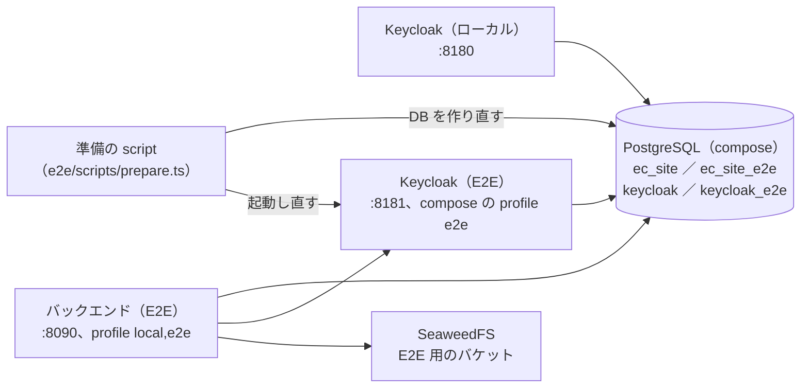

# Plan 004：開発の基盤の整理

ステータス：承認済み（tasks 作成済み）　対象：[spec.md](spec.md)

整理の spec なので、モジュールの設計書は変えない。本書には、決めたことと段取りを書く。

| 対象 | 本書 | 主な担当 |
|------|------|----------|
| 規則の文書 | 第 1 節 | DS-1、DC-63 |
| CI | 第 2 節 | DS-2 |
| ライセンス | 第 3 節 | DS-3 |
| テストの網 | 第 4 節 | DS-4 |
| リポジトリの構成 | 第 5 節 | DS-5 |
| E2E とデータ | 第 6 節 | DS-6、DS-7 |

## 1. 規則の文書（DS-1、DC-63）

### 1.1 文書の置き場所

```
docs/
├── constitution.md   長期のルール（変えない）
├── notation.md       文書の記号と番号（DC-5。草案は作成済み）
├── glossary.md       用語と識別子
├── style/            コードの書き方とプロジェクトの習慣（DC-1）
│   ├── README.md     一覧と、規則の書き方
│   ├── backend.md    層とパッケージ、エラーの変換、入力の検証、命名
│   ├── frontend.md   画面の構成、部品、状態、スタイル
│   ├── testing.md    テストの種類と置き場所、テスト名、待ち方
│   ├── comments.md   コメント（Javadoc・TSDoc、複雑な処理の前、型の項目）
│   └── review.md     見直しで読む規則の一覧（DC-4）
├── dev/              開発の手順（DC-63。README から移す）
│   ├── setup.md      起動、compose、アカウント
│   ├── testing.md    テストの流し方（単体、統合、フロント、E2E）
│   └── environment.md 環境変数
├── modules/、frontend/、specs/   今のまま
```

- **constitution と style の分担**：constitution は原則（何を守るか、なぜ）、style は具体的な書き方（どう書くか、例）。食い違ったら constitution が正しい（AGENTS.md と同じ）。style の規則は constitution の節を引いてよいが、同じ文を写さない。
- **style の規則の形**：1 規則 = 1 項目。「規則」「理由」「確かめ方」（自動：ArchUnit・Biome・テスト・CI の script、人手：見直し）を書く。自動で確かめられる規則は、道具の設定かテストへのリンクを付ける。人手のものは `review.md` の一覧に載せる（DC-4）。
- **本 spec で書く範囲**：今のコードで守られている習慣だけ（DC-1）。例：DB の制約の違反は `ConstraintViolationTranslator` で業務の例外に変える（各 Repository の `CONSTRAINTS`）、生成した API の interface を実装する、`@Transactional` は application の層だけ、テスト名に AC 番号、店舗画面のサーバーアクションの `unstable_rethrow`。spec 005・006 で決まる規則（標準の構成、エラーのキー、i18n）は、その spec で足す。
- **README**（DC-63）：概要、文書の地図、進め方、進捗、「起動とテスト」への 1 行のリンクに絞る。起動・アカウントの表・テスト・環境変数の表は `docs/dev/` に移す。AGENTS.md の「起動・テストの手順は README の「起動とテスト」」を `docs/dev/` に直す。skill `local-dev` の参照も直す。

### 1.2 AGENTS.md と skill（DC-2、DC-3、DC-5）

- AGENTS.md の「最初に読むもの」に `docs/notation.md` と `docs/style/` を足す。
- AGENTS.md に「skill の一覧」の節を足す（名前、いつ使うか、1 行）。`description` の写しにしない。skill を足す・消すときは一覧も直す決まりを、skill `writing-for-agents` のこのリポジトリ向けの追記に書く（DC-2）。
- AGENTS.md「セッションの始めと終わり」と skill `handoff` の追記（DC-3）：
  - 置き場所：`/.local/handoff/yyyyMMddHHmmss-<名前>/`。中の MD は 1 つでも複数でもよい。
  - 新しいセッションは、指示がなければ、名前の日時が最も新しいものを読み、状態（未 push の commit、次のタスク）を確かめる。
  - 古いものは利用者が消す。エージェントは消さない・消すかを聞かない。

### 1.3 constitution の変更

| 節 | 変更 | DC |
|----|------|----|
| 15 | spec の 2 つの種類（機能・整理）と、それぞれの書き方。整理の spec は DS・DC・DN、「目的」「完了の条件」、対象 D。「1 つの spec は機能の縦切り 1 つ」は機能の spec の規則にする | DC-6 |
| 13 | CI の結果に関わらないファイルだけの push では CI を流さない（原則だけ。一覧は CI の設定）。pull request はいつも流す | DC-7 |
| 12.1 | 店舗画面のサーバーの処理は、Node の上でテストする（第 4.3 節）。「結合テストを置かない」を、表示の部品とサーバーの処理に分けて書き直す。テスト名の AC 番号は 1 つずつ書く。カバレッジは報告だけ | DC-11、12、14 |
| 新 17 | 依存とライセンス：プロジェクトのライセンス（MIT）、依存のライセンスの方針（第 3 節）、有料の版がある製品の使う範囲 | DC-8、9 |
| 4・9・その他 | パスの記述（`backend/`、`frontend/e2e/`、`compose.yaml`）を新しい置き場所に（第 5 節） | DC-21 |

## 2. CI（DS-2）

### 2.1 流さない変更（DC-7）

`on.push.paths-ignore` に次を書く。`pull_request` には書かない（いつも流す）。

| 流さない | 理由 |
|----------|------|
| `**.md`（文書、skill の本文） | 実行に使わない |
| `.claude/**` | エージェントの設定とローカルの画面の確認の設定 |
| `scripts/dev/**` | ローカル用の script（CI で使う script は `scripts/ci/` に置き、流す側にする） |
| `.gitignore`、`LICENSE` | 実行に使わない |

流す側（既定）：`api/`、`backend/`、`frontend/`、`e2e/`、`docker/`、`scripts/ci/`、`.github/`、`.gitattributes`、ルートの workspace の設定。`scripts/check-frontend.sh` は `scripts/dev/` に移す。

- `concurrency.cancel-in-progress` は今のまま。
- この変更を入れた commit を push するときに、未 push の `948afe9`（T3606）を一緒に push する（利用者の決定）。

### 2.2 フロントの準備の共通化（DN-3 の範囲で）

- `.github/actions/setup-frontend/`（composite action）：pnpm と Node の準備、workspace の `pnpm install --frozen-lockfile`。admin・store・e2e の job が使う。
- Playwright のブラウザーを `~/.cache/ms-playwright` でキャッシュする（キーは Playwright の版）。キャッシュが当たったときは `install-deps` だけを行う。
- 依存の更新の提案（Dependabot）と脆弱性の検査は入れない（spec の Non-goals）。

## 3. ライセンス（DS-3）

### 3.1 プロジェクトのライセンス（DC-8）

- リポジトリの直下に `LICENSE`（MIT の標準の文。著作権者 `roger88106`、年 2026）。GitHub の画面では作らず、`develop` に commit する（push 後に GitHub が MIT と判定する）。
- `package.json`（ルートの workspace、admin、store、e2e）の `license` に `MIT`。バックエンドは Maven の成果物を公開しないので POM がなく、直下の `LICENSE` で示す。

### 3.2 依存の方針（DC-9）

constitution 新 17 節に原則、`scripts/ci/licenses/policy.json` に一覧を置く。

| 区分 | ライセンス | 扱い |
|------|------------|------|
| 許可 | MIT、MIT-0、Apache-2.0、BSD-2-Clause、BSD-3-Clause、ISC、0BSD、BlueOak-1.0.0、CC0-1.0、Zlib、PostgreSQL、Unlicense、Python-2.0 | そのまま使える |
| 条件付き | EPL-1.0・2.0、MPL-2.0、LGPL-2.1・3.0、CDDL、CC-BY-4.0（データ）、OFL-1.1（字体）、GPL-2.0 with Classpath-exception | 改変せずに依存として使う場合だけ。**部品ごとに**理由を書いて一覧に載せる（新しい部品は CI が止める） |
| 禁止 | GPL（例外なし）、AGPL、SSPL、BUSL、Commons Clause、非商用限定、ライセンスが分からないもの | 使わない |

- 複数のライセンスから選べるもの（`A OR B`）は、許可のものが 1 つあればよい。`A AND B` はすべてが許可か条件付きの一覧にあること。
- 有料の版がある製品（jOOQ：オープンソースの DB でだけ無料、Flyway：Community の機能だけ、imgproxy：OSS 版の機能だけ、Keycloak：上流のコミュニティ版）は、constitution 17 節に使う範囲を書く。

### 3.3 検査（DC-10）

| 対象 | 道具 | 範囲 |
|------|------|------|
| バックエンド | `com.github.jk1.dependency-license-report`（`checkLicense` の task、`allowedLicensesFile` と表記の正規化） | 実行時、コンパイル時、テスト（単体・統合）、注釈の処理、jOOQ のコード生成の設定 |
| フロント | `scripts/ci/licenses/check-frontend.mjs`（`pnpm licenses list --json` を方針と照らす） | workspace のすべて（開発用を含む） |
| Gradle のプラグイン | 一覧を `policy.json` に手で書き、見直しで確かめる（openapi-generator、jOOQ のプラグイン、jk1 自身） | プラグインは依存の構成に出ないため |

- CI：バックエンドの job で `./gradlew checkLicense`、フロントの job（store）で script を流す。
- 調べ残し（`/.local/memo/licenses.md` の要確認）を最初に片付ける：jOOQ の POM の表記、テスト・ビルド用の依存、`.claude/skills/` の LICENSE のコピー（原文の著作権表示が保たれているか）、Keycloak のテーマの CSS。
- 第三者の告知のファイルと SBOM は作らない（spec の Non-goals）。

## 4. テストの網（DS-4）

### 4.1 カバレッジ（DC-11）

- バックエンド：Gradle の `jacoco` のプラグイン。`test` と `integrationTest` の実行データを合わせた報告の task を `check` の後に流す。生成したコード（jOOQ、OpenAPI）は除く。
- フロント：`@vitest/coverage-v8`。admin と store の `test` に `--coverage` を付ける（報告は `coverage/`）。
- CI：報告を artifact に保存し、合計（行・分岐）を job の summary に書く。基準の値による失敗はさせない。
- 測った基準（2026-10-12、手元）：バックエンド 行 97.9%・分岐 83.4%、admin 行 79.0%、store 行 26.4%。

### 4.2 AC とテストの対応（DC-12、DC-13）

- `scripts/ci/ac-check.mjs`：機能の spec（`docs/specs/*/spec.md` で `AC-n` を持つもの）の AC を取り出し、テスト名（Java の `@DisplayName`、Vitest・Playwright の `test`・`it`・`describe` の第 1 引数）にある `AC-n` と照らす。足りなければ失敗する。
  - テスト名の `AC-n〜m` の範囲の表記は、失敗にする（DC-12）。今の 17 件は、確かめている AC を 1 つずつ並べる形に直す（テストを変えるのは名前だけ）。
  - 除外の一覧：`scripts/ci/ac-exclusions.json`（AC と理由）。
  - CI：軽い job（Node だけ）で流す。
- AC-119（DC-13）：店舗画面のヘッダーの表示の部品のテストで、ログインしている会員に「アカウント」のリンク（IdP のアカウントの画面）が出ることを確かめる。

### 4.3 店舗画面のサーバーの処理（DC-14）

- Vitest（Node）で、サーバーアクション、`api/cart.ts`、`auth.ts` のコールバック、`proxy.ts` を呼ぶ。
  - 置き換えるもの：`next/headers`（Cookie とヘッダーの入れ物）、`next/navigation`（`redirect` は例外を投げる。`unstable_rethrow` で通ることを確かめる）、`next/cache`、`@/auth` の現在の会員と token。バックエンドは MSW（`msw/node`）で置き換える。
  - 置き換えの部品は `src/test/` に置く（admin の `src/test/` と同じ形）。
- 確かめる流れ：カートに入れる・数量・削除（ゲスト、会員）、ログインの後のカートの引き継ぎ（成功、上限の切り詰め、失敗のときに Cookie を消す）、注文手続き（入力のエラー、確定、401 で再ログインへ）、ログイン・ログアウト（戻り先、IdP のログアウトの URL）、token の取り直し。
- constitution 12.1 と `docs/frontend/store.md` 第 7 節を先に直す（文書が先）。

### 4.4 管理画面のカテゴリの画面（DC-15）

結合テスト（Vitest + React Testing Library + MSW）で、spec 001 の US-2 の画面の操作を確かめる：一覧（木）の表示、登録（親あり・なし）、名前の変更、並び順の変更、削除（子・商品があるときのエラーの表示）。テスト名に AC-8〜12 を 1 つずつ入れる。

### 4.5 画像の失敗（DC-16）と待ち方（DC-17）

- 画像の変換：imgproxy が 4xx・5xx を返す、応答が遅い（時間切れ）、形式の違う応答。保存：配信のバケットに書けない、受付のファイルがない。期待する振る舞い（エラーの種類、アセットを記録しない）は今の実装のとおり（media.md）。統合テストで、変換は HTTP の差し替え（テスト用の小さな HTTP サーバー）、保存は止めたコンテナか存在しないバケットで起こす。
- `Thread.sleep` の 2 か所：
  - `MediaApiTest`（取り消されたときにファイルが消えない）：イベントの登録表（`event_publication`）に解放のイベントが無いことを確かめる（取り消されたトランザクションでは登録されない）。待たない。
  - `S3ObjectStorageTest`（期限の切れた URL）：署名の時計を過去にずらした署名者で URL を作り、作った時点で期限が切れている URL で確かめる。

## 5. リポジトリの構成（DS-5）

### 5.1 移動（DC-18）

| 今 | 後 |
|----|----|
| `backend/` | `backend/ecsite/` |
| `frontend/e2e/` | `e2e/` |
| `compose.yaml` | `docker/compose.yaml`（`name: ec-site` を足す） |
| `compose/postgres/`、`compose/seaweedfs/` | `docker/postgres/`、`docker/seaweedfs/` |
| `keycloak/realms/`、`keycloak/themes/` | `docker/keycloak/realms/`、`docker/keycloak/themes/` |
| `scripts/check-frontend.sh` | `scripts/dev/check-frontend.sh` |

- 1 つ目の commit は `git mv` だけ（DN-2）。2 つ目で参照を直す。
- compose の起動の指令：ルートに `.env`（`COMPOSE_FILE=docker/compose.yaml` だけ）を置き、今の `docker compose up -d` をそのまま使えるようにする。compose の中の相対パスは `docker/` を基準に直す。
- volume（DC-19）：`name: ec-site` で project の名前を今と同じにし、volume の名前（`ec-site_postgres_data` など）を変えない。移す前後でローカルの DB・画像・Keycloak のデータが残ることを手で確かめる。

### 5.2 参照の修正（DC-19、DC-21）

`git grep` で見つけた参照（2026-10-12）を直す。

| 種類 | ファイル |
|------|----------|
| 相対パス | `build.gradle.kts`（`../api/openapi` → `../../api/openapi`）、`e2e/package.json`（`../../api` → `../api`）、`playwright.config.ts`（`../../backend` → `../backend/ecsite`、`../admin` → `../frontend/admin`） |
| compose・realm のパス | `TestcontainersConfig`、`KeycloakIntegrationTest`、`AdminRealmPermissionContractTest`、`RealmSettingsContractTest`、`AdminApiPermissionContractTest`、`application-local.yml` のコメント |
| CI | `working-directory`、キャッシュのパス、artifact のパス |
| 文書 | constitution、README・`docs/dev/`、AGENTS.md、`docs/modules/*.md`（`../../backend` のリンク 7 ファイル）、`docs/frontend/store.md`、skill `local-dev`、`.gitignore` |
| その他 | `e2e/tests/images.spec.ts`（バックエンドのテストの画像のパス）、IntelliJ の Gradle のリンク（利用者が取り込み直す） |

spec・plan・tasks（001〜003）の中のパスは記録なので直さない（DC-21）。

### 5.3 フロントの workspace（DC-20）

- ルートに `package.json`（`private`、`license: MIT`、`packageManager`、全体の `lint`・`typecheck`・`test` の script）、`pnpm-workspace.yaml`（`frontend/*`、`e2e`。006 で共有のパッケージ `frontend/shared` を足す）、`pnpm-lock.yaml` を置く。各プロジェクトの lock と `pnpm-workspace.yaml` は消す（`allowBuilds` はルートに集める）。
- 共通の設定：`frontend/biome.base.jsonc`、`frontend/tsconfig.base.json` を作り、admin・store・e2e が `extends` で読む。各プロジェクトには違う所（store の `.next` の除外、JSX の設定など）だけを残す。
- 依存の版を揃える（`@biomejs/biome` の書き方の違いなど）。`pnpm install` の後に、admin・store・e2e の lint・型チェック・テスト・ビルドが通ることを確かめる。
- shadcn の CLI（`components.json`）が workspace で動くことを確かめる。

## 6. E2E とデータ（DS-6、DS-7）

### 6.1 E2E の環境（DC-22〜25）



- **データベース**：同じ PostgreSQL の別の database `ec_site_e2e`。E2E の前に、準備の script が作り直す（`docker compose exec postgres psql` で DROP・CREATE）。バックエンドの起動時に Flyway がマイグレーションと E2E 用の seed を適用する。
- **IdP**：Keycloak を E2E 用にもう 1 つ（compose の profile `e2e`、ポート 8181、database `keycloak_e2e`）。realm の JSON は同じものを取り込む。準備の script が database を作り直してから起動し直すので、毎回、realm の JSON の状態（アカウントは固定の 4 人）から始まる。E2E の会員登録はここに作られ、ローカルの Keycloak には残らない（DC-23）。
- **バックエンド**：profile `local,e2e` で起動する。`application-e2e.yml` はローカルとの違いだけ：ポート 8090、database `ec_site_e2e`、seed の場所、issuer（8181）、画像のバケット（E2E 用）。手元の開発のバックエンド（8080）と並べて動かせる。E2E のバックエンドは毎回起動し直す（使い回すと、作り直した DB とつながらないため）。
- **画像**：E2E 用のバケット（受付・配信）を `seaweedfs-init` で作り、imgproxy の読める範囲に足す。
- **画面**：admin は `VITE_OIDC_AUTHORITY`（8181）と、API の転送先（`vite.config.ts` の転送先を環境変数で変えられるようにする）を渡してビルドする。store は `STORE_API_BASE_URL`（8090）、`AUTH_KEYCLOAK_ISSUER`（8181）を渡す。
- `pnpm test`（e2e）＝準備の script → Playwright。CI も同じ。
- 実行ごとの印（`RUN_ID`）は残す（同じ実行の中のテストどうしで、データが混ざらないため）。

### 6.2 seed の分け方（DC-25、DC-26）

| 置き場所 | 中身 | 使う profile |
|----------|------|--------------|
| `db/seed/base/` | 税区分と税率（送料の税区分の固定の ID を含む） | local、e2e |
| `db/seed/local/` | 画面で見るためのデータ（第 6.3 節） | local |
| `db/seed/e2e/` | E2E だけに要るデータ（今は無し。要るものが出たら足す） | e2e |

- E2E が `seed/local` のデータに依存していないかを、最初に確かめる（税区分の「標準」「軽減」以外）。

### 6.3 ローカルの画面のデータ（DS-7、P2）

- カテゴリ：2 階層、4〜5 の最上位カテゴリ。商品：12〜15（各カテゴリに 1 つ以上、軸あり・なし、販売停止のバリアント、公開の予約を含む）。在庫：在庫切れと残りわずか（引当を含む）を含む。
- 注文：会員 `member@example.com` の注文で、状態（受付、キャンセルの申請中、申請の却下、キャンセル済み）をそれぞれ 1 件以上。会員の ID を seed で固定するため、realm の JSON の会員に固定の ID を付ける（Keycloak の取り込み直しが要る。`docs/dev/setup.md` に書く）。
- 画像：生成した画像（利用者の Gemini。`agy` が使えなければ、エージェントが提示詞を出し、利用者が手で作る）を WebP にして `docker/seaweedfs/seed/assets/` に置き、`seaweedfs-init` が配信のバケットの `assets/{アセット ID}.webp` に写す。アセットと商品画像の行は SQL の seed で固定の ID で作る。アップロードの流れ（受付・確定）は通さない（seed は配信の状態を直接作る）。
- 画像の生成の提示詞と、商品の一覧（名前、カテゴリ、価格、在庫）は、段階 7 の最初のタスクで作り、利用者に確かめてから画像を作る。
- `scripts/dev/mkorder.js` は、seed で注文が揃うので消す（使っている文書も直す）。

## 7. 確かめ方（DC と確かめる方法）

| DC | 確かめ方 |
|----|----------|
| 1、2、5、63 | 見直しで読む（文書がある、AGENTS.md から引ける） |
| 3 | 段階の区切りで引き継ぎの文書を作り、新しいセッションで読めることを確かめる（見直し） |
| 4 | 本 spec の見直しの段階を、`docs/style/review.md` を使って行う |
| 6、9 | 見直しで読む |
| 7 | MD だけの commit を push して CI が流れないこと、pull request で流れることを確かめる |
| 8 | GitHub のリポジトリの画面で MIT と判定される。`package.json` に `license` |
| 10 | 禁止のライセンスの部品を足すと CI が失敗することを、一度だけ手元で確かめる |
| 11 | CI の artifact と summary |
| 12 | `ac-check.mjs` が CI で通る。範囲の表記と、足りない AC で失敗することを script のテストで確かめる |
| 13〜17 | 各テストが通る。`Thread.sleep` がテストに無い（`git grep`） |
| 18〜21 | 移した後に CI がすべて通る。`docs/dev/` の手順で手元で起動できる。volume のデータが残る |
| 22〜25 | E2E を 2 回続けて流して、どちらも通る。流す前後でローカルの DB の行数と Keycloak の会員の数が変わらない |
| 26 | 手元で画面を見て確かめる（見直し） |
| DN-1 | すべてのテストが通る。API の契約に変更がない（`api/` の差分が無い） |
| DN-2 | `git log --stat` で移動の commit を確かめる |
| DN-3 | 直近の CI（2026-10-12、全体 9 分 39 秒：バックエンド 4 分 29 秒、E2E 5 分 5 秒）と比べて 1 割以内（10 分 37 秒まで） |

## 8. 実装の順序

tasks は段階ごとに `tasks/` の 1 ファイルにする（[01](tasks/01-docs.md)、[02](tasks/02-ci.md)、[03](tasks/03-tests.md)、[04](tasks/04-layout.md)、[05](tasks/05-licenses.md)、[06](tasks/06-e2e-data.md)、[07](tasks/07-local-data.md)、[08](tasks/08-review.md)）。タスク番号は `T4` ＋ 段階 ＋ 連番（例：T4101）。

| # | 段階 | 完了条件 |
|---|------|----------|
| 1 | 規則の文書（第 1 節：constitution、AGENTS.md、skill、`docs/style/`、`docs/dev/`、README、notation、用語集、LICENSE） | DC-1〜6、8、9、63 の文書がある |
| 2 | CI の流さない変更（第 2.1 節） | MD だけの push で CI が流れない。`948afe9` を含めて push し、CI が通る |
| 3 | テストの網（第 4 節） | DC-11〜17 のテストと script が CI で通る |
| 4 | リポジトリの構成と workspace（第 5 節、第 2.2 節） | 移した後に CI がすべて通り、手元で起動できる。DN-3 の時間に収まる |
| 5 | ライセンスの検査（第 3.3 節） | 方針に合わない部品で CI が失敗し、今の依存では通る |
| 6 | E2E とデータの分離（第 6.1、6.2 節） | E2E を流してもローカルのデータが変わらない |
| 7 | ローカルの画面のデータ（第 6.3 節、P2） | DC-26 を画面で確かめる |
| 8 | 見直し | `docs/style/review.md` で確かめ、`.local/agent/check-zh.mjs --all` が通り、文書の中国語の言い回しを読んで直す。README の spec の状態を直す |
