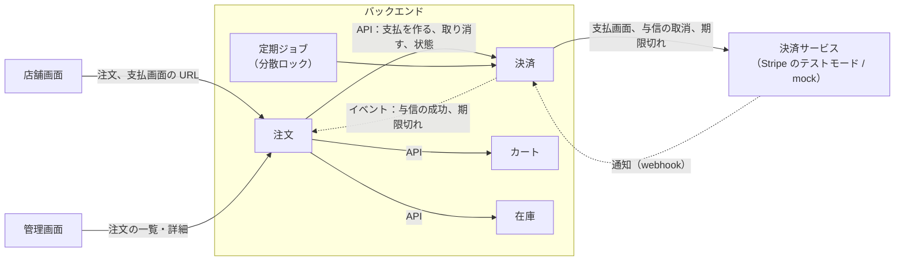

# Plan 007：決済

ステータス：承認済み（tasks 作成済み）　対象：[spec.md](spec.md)

本 spec で変更するモジュールの設計は、各モジュールの設計書に書く。本書には、モジュールをまたぐ決定と、実装の手順だけを書く。

| 対象 | 設計書 | 主な担当 |
|------|--------|----------|
| 定期ジョブとイベントの再発行（新規。モジュールではない） | 本書 第 2 節、[バックエンドのアーキテクチャ](../../backend/architecture.md) 第 5 節 | AC-154、164、NFR-7 |
| 決済（新規） | payment.md（段階 2 で作る） | US-31〜34 の支払と与信、BR-15〜17、NFR-5、6、8 |
| 注文（変更） | [order.md](../../backend/modules/order.md) | 状態の遷移（BR-14）、期限切れのキャンセル、画面の表示 |
| カート（変更） | [cart.md](../../backend/modules/cart.md) | 注文した品目を除く（AC-147） |

用語と識別子の対応は[用語集](../../reference/glossary.md)。

## 1. 全体の構成

| 決定 | 内容 |
|------|------|
| 依存の向き | 注文 → 決済（API）の一方向。決済は注文に依存せず、結果をイベントで伝える ※1 |
| 支払を作る時点 | 注文の成立と同じトランザクションで、決済の API で支払（未払い）を作る。決済サービスは呼ばない |
| 支払画面 | 注文の成立の後、店舗画面のサーバーが支払画面の URL を取得する。決済の API が、開いている支払画面があれば返し、なければ決済サービスに作らせる（AC-152） |
| 与信の成功 | 決済が通知を受信して「与信済み」にし、イベントを出す。注文がイベントを受け取って「受付」にし、カートから品目を除く |
| 期限切れ | 決済の定期ジョブが、決済サービスの支払画面を閉じてから「支払なし」にし、イベントを出す。注文がイベントを受け取ってキャンセルにし、在庫を戻す（同じトランザクション） |
| 期限切れの後の与信 | 決済が、支払なしの支払で与信の成功の通知を受信したら、与信の取消待ちにして取り消す。与信の成功のイベントは出さない（AC-157） |
| キャンセルの与信の取消 | 注文のキャンセルと同じトランザクションで、決済の API で「与信の取消待ち」にする。決済サービスの呼び出しはコミットの後（第 3.3 節） |
| 管理画面の支払の状態 | 注文の管理 API が、決済の API から状態を読んで応答に含める |

※1：決済が注文のイベントを受け、注文が決済のイベントを受けると、モジュールが循環する（Spring Modulith の検証で失敗する）。注文が決済を呼ぶ向きにそろえる。

## 2. 定期ジョブと未完了イベントの再発行

constitution の未定事項「定期ジョブの分散ロック方式」と「未完了イベントの自動再発行」を、ここで決める。

| 決定 | 内容 | 確認方法 |
|------|------|----------|
| 分散ロック | ShedLock（JDBC の provider、PostgreSQL のテーブル）で、同じジョブを同時に 1 インスタンスだけで実行する | 2 つのスケジューラーから同時に起動し、1 回だけ実行される統合テスト |
| 業務の正しさ | 分散ロックに頼らず、行ロックと冪等な状態の遷移で保つ。ロックは無駄な重複を減らすため | 期限切れを 2 回実行しても 1 回だけキャンセルになる統合テスト（NFR-7） |
| 未完了イベントの再発行 | 定期ジョブ（1 分ごと、分散ロック付き）で、5 分より前の未完了のイベントを再発行する。起動時の再発行は無効のまま | 失敗したリスナーが次の回で処理される統合テスト |
| 期限切れのジョブ | 1 分ごと。期限を過ぎた「未払い」の支払を処理する。AC-154 の「一定時間」は 5 分 | 第 7 節 |
| ジョブの置き場所 | 業務のジョブはモジュールの `application` に置く。分散ロックと再発行の設定は `config` に置く | モジュール境界の検証 |

- 再発行は、全てのリスナーが冪等であることを前提にする（バックエンドのアーキテクチャ 第 5 節）。既存のリスナーは冪等に作ってある。
- 在庫の設計書の「イベントの処理に失敗したとき」の復旧の手順は、自動の再発行に書き換える。
- 期限切れのカートと引当の削除（spec 002 の Non-goals）は、本 spec では行わない。

理由：ShedLock は、定期ジョブの重複を防ぐ定番のライブラリで、Apache License 2.0。DB の外の仕組み（Redis など）を追加せずに済む（constitution の後から導入する技術）。

## 3. 決済サービスとの連携

### 3.1 port と切り替え

| 決定 | 内容 |
|------|------|
| port | 決済の `application` に、支払画面を作る、支払画面を閉じる、与信を取り消す、の 3 つを置く。決済サービスの型は `infrastructure` の外に出さない |
| 実装 | Stripe（`stripe-java`、MIT）と mock。設定 `ecsite.payment.gateway`（`mock` / `stripe`）で切り替える。既定は `mock` |
| 支払画面 | Stripe Checkout。与信だけを取る（`capture_method=manual`）。金額は総額（円）、通貨は JPY |
| 支払画面の期限 | 作るときは決済サービスの最短（作ってから 30 分）にし、注文の支払の期限で、期限切れのジョブが閉じる ※1 |
| 通知のエンドポイント | `POST /api/webhooks/stripe`。認証は付けず、署名で確認する（BR-17）。OpenAPI には書かず、決済の設計書に書く |
| 受け取る通知 | 与信の成功と、支払画面の期限切れ。通知の種類の名前は、段階 4 の着手時に sandbox で確認して決める |
| 秘密の値 | `STRIPE_SECRET_KEY`、`STRIPE_WEBHOOK_SECRET`。環境変数で渡し、Git に入れない（NFR-8）。ローカルの値は `/.local/` に置く |

※1：Stripe Checkout の期限は、作ってから 30 分より短くできない。支払画面を再作成したとき（AC-151）、画面の期限が注文の支払の期限より後になるので、期限はジョブで支払画面を閉じて、注文の支払の期限に一致させる。

### 3.2 mock

| 決定 | 内容 |
|------|------|
| 支払画面 | バックエンドが `/mock-payment/{id}` に簡単な HTML を返す（`mock` のときだけ）。「支払う」「カードを拒否させる」「やめる」の操作を持ち、店舗の注文の画面に戻す |
| 通知 | mock は、HTTP を経由せず、通知を処理するアプリケーションのサービスを直接呼び出す |
| テストからの操作 | テストのコードから、与信の成功・通知の遅れ・重複・順序の入れ替わり・取消の失敗（N 回）を再現できる（NFR-6） |
| 署名の検証のテスト | Stripe の実装の単体テストで、テストの鍵で署名した通知を作って確認する |

### 3.3 与信の取消

1. 注文のキャンセルのトランザクションで、決済の API が支払を「与信の取消待ち」にし、決済の中のイベントを登録する。
2. コミットの後、決済のリスナーが決済サービスに取消を求め、成功したら「与信の取消済み」にする。
3. 失敗したらリスナーが例外で終わり、イベントは未完了で残る。第 2 節の再発行で再試行する（AC-164）。
4. 決済サービスで取消済みのときも、成功として扱う（AC-166）。

### 3.4 ローカルで Stripe を使う

- compose に `stripe-cli`（公式のイメージ `stripe/stripe-cli`）を、profile `stripe` で追加する。`stripe listen --forward-to` で、通知をローカルのバックエンドに送る。
- 既定の起動（profile なし）、自動テスト、CI、E2E は mock を使い、外部に接続しない。
- 手順は [開発環境の起動](../../dev/setup.md) と [環境変数](../../dev/environment.md) に書く。

## 4. 決めたこと

| 項目 | 決定 |
|------|------|
| 支払の状態（BR-15） | 未払い（`UNPAID`）、与信済み（`AUTHORIZED`）、与信の取消待ち（`VOID_PENDING`）、与信の取消済み（`VOIDED`）、支払なし（`NOT_PAID`） |
| 注文の状態 | 支払待ち（`PENDING_PAYMENT`）を追加する |
| 期限切れのキャンセル | 注文のキャンセルの種類に「支払期限切れ」を追加する。運営者も理由の文もない |
| 支払の期限（BR-16） | 注文日時 ＋ 30 分。設定 `ecsite.payment.deadline`（既定 `30m`）。テストでは短くする |
| 二重の通知・順序の入れ替わり | 支払の状態の遷移を冪等にし、遷移できない通知は記録して無視する。通知の ID の記録は持たない |
| 期限の直前の与信（AC-156） | ジョブは、決済サービスの支払画面を閉じてから「支払なし」にする。閉じられなかった（支払が完了していた）ら、何もせず通知を待つ |
| 戻った画面の「支払の確認中」（AC-150） | 決済サービスから戻る URL にクエリパラメーター（`?payment=returned`）を付け、注文がまだ「支払待ち」なら表示する |
| 支払画面の URL を取得する API | 支払待ちで期限の前の注文だけ。それ以外は 409 |
| カートから除く品目（AC-147） | 注文の明細のバリアントを、数量によらず行ごと除く。カートの版が上がり、注文手続き中の引当は今までどおり解除される |
| 管理画面の一覧の支払の状態 | 一覧の 1 ページ分の注文 ID で、決済の API からまとめて読む |
| 依存とライセンス | `stripe-java`（MIT）、`shedlock-spring`・`shedlock-provider-jdbc-template`（Apache License 2.0）。[依存とライセンス](../../reference/licenses.md) に追加する |

## 5. API

項目の定義は OpenAPI（[admin.yaml](../../../api/openapi/admin.yaml)、[store.yaml](../../../api/openapi/store.yaml)）。

### 5.1 C 側（`/api/store`）

| Method | Path | 変更 | AC |
|--------|------|------|----|
| POST | `/checkouts/{checkoutId}/order` | 注文は「支払待ち」で作られる。応答は変えない | 143、144 |
| POST | `/orders/{orderId}/payment-page` | 新規。支払画面の URL を返す（注文した会員だけ。支払待ちで期限の前の注文だけ） | 143、151、152 |
| GET | `/me/orders`、`/orders/{orderId}` | 状態に「支払待ち」、支払の期限、キャンセルの種類「支払期限切れ」、できる操作に「支払う」を追加する | 155、159 |

### 5.2 B 側（`/api/admin`）

| Method | Path | 変更 | AC |
|--------|------|------|----|
| GET | `/orders` | 状態の絞り込みに「支払待ち」、各行に支払の状態を追加する | 160、161 |
| GET | `/orders/{orderId}` | 支払の状態、キャンセルの種類「支払期限切れ」を追加する。支払待ちではキャンセルの操作を表示しない | 155、158、160、165 |

- 権限は既存の注文の参照・更新のまま。

## 6. フロントエンド

| | store（C 側） | admin（B 側） |
|---|---|---|
| 注文手続き | 注文したら支払画面の URL を取得して遷移する。取得に失敗したら、注文画面に遷移し「支払う」を表示する | |
| 注文の詳細 | 支払待ちなら、支払の期限と「支払う」。戻った直後で支払待ちなら「支払の確認中」。期限切れのキャンセルを示す | 支払の状態。与信の取消待ちを示す。期限切れのキャンセルを示す |
| 注文の一覧 | 支払待ちの支払の期限 | 支払の状態の列、状態の絞り込みに「支払待ち」 |

- 画面の文言は、店舗画面・管理画面の文言のファイルに追加する（[店舗画面の構成](../../frontend/apps/store.md)、[管理画面の構成](../../frontend/apps/admin.md)）。

## 7. テスト

| 対象 | 単体 | 統合 | E2E |
|------|------|------|-----|
| 支払（BR-15、17） | 状態の遷移、重複・順序の入れ替わり | 支払の作成、支払画面を開き直しても 1 つ（AC-152）、与信の成功で注文が受付になる | |
| 期限切れ（US-32） | | 期限切れでキャンセルと在庫の戻し、5 分以内（AC-154）、直前の与信はキャンセルしない（AC-156）、後から届いた与信を取り消す（AC-157）、2 回実行しても 1 回（NFR-7） | |
| 与信の取消（US-34） | | キャンセルの理由ごとに取消（AC-162）、取消の失敗を再発行で再試行する（AC-164）、重ねても変わらない（AC-166） | |
| 定期ジョブ | | 分散ロックで 1 回だけ、未完了イベントの再発行 | |
| Stripe の実装 | 署名の検証、決済サービスの応答の変換（記録した応答で） | | |
| 注文・カート | 支払待ちの遷移、支払待ちはキャンセルできない（AC-158） | 注文した品目だけをカートから除く（AC-147）、管理画面の絞り込みと支払の状態 | |
| 店舗画面 | 支払の期限、支払の確認中、支払う | | mock で注文 → 支払う → 受付。カードの拒否 → 再試行。期限切れ（期限を短くした設定で） |
| 管理画面 | | 支払の状態の表示、支払待ちの絞り込み（結合テスト） | 支払済みの注文をキャンセルし、与信の取消済みになる |
| 横断 | | モジュール境界の検証（循環がない） | |

- Stripe の sandbox は、段階 4 で手動で確認する（自動のテストには入れない。NFR-6）。

## 8. 実装の順序

tasks は段階ごとに `tasks/` の 1 ファイルにする（[01](tasks/01-scheduling.md)、[02](tasks/02-payment.md)、[03](tasks/03-order-cart.md)、[04](tasks/04-stripe.md)、[05](tasks/05-store-ui.md)、[06](tasks/06-admin-ui.md)、[07](tasks/07-e2e-ci.md)、[08](tasks/08-review.md)）。タスク番号は `T7` ＋ 段階 ＋ 連番（例：T7101）。

| # | 段階 | 完了条件 |
|---|------|----------|
| 1 | 定期ジョブの基盤（ShedLock、未完了イベントの再発行、constitution・バックエンドのアーキテクチャ・在庫の設計書の更新） | 分散ロックと再発行の統合テストが通る |
| 2 | 決済モジュール（支払、mock、API、期限切れのジョブ、与信の取消、マイグレーション、payment.md、用語集） | 決済の単体・統合テストが通る |
| 3 | 注文とカートの変更（支払待ち、イベントの受け取り、期限切れのキャンセル、品目を除く、OpenAPI） | AC-143〜166 のバックエンドのテストが通る。既存のテストが全て通る |
| 4 | Stripe の実装（Checkout、通知のエンドポイント、compose の `stripe-cli`、開発環境の文書） | 署名の検証のテストが通る。sandbox で注文から与信、キャンセルから取消までを手動で確認する |
| 5 | 店舗画面 | 画面から注文・支払・期限切れが確認できる（mock） |
| 6 | 管理画面 | 支払の状態と支払待ちの絞り込みが表示される |
| 7 | E2E と CI | E2E が CI で通る |
| 8 | レビュー | 実装と文書の食い違い、読みにくさ、コメントの不足を修正し、テストが通る |
