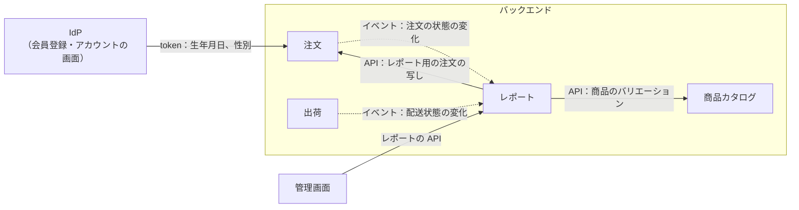

# Plan 010：売上の簡易レポート

ステータス：承認済み（tasks 作成済み）　対象：[spec.md](spec.md)

本 spec で変更するモジュールの設計は、各モジュールの設計書に書く。本書には、モジュールをまたぐ決定と、実装の手順だけを書く。

| 対象 | 設計書 | 主な担当 |
|------|--------|----------|
| レポート（新規） | reporting.md（段階 2 で作る） | 集計の写し、状態の履歴、3 つのレポート、権限（US-41〜43、45、47、BR-24〜28、NFR-12〜14、16） |
| 注文（変更） | [order.md](../../backend/modules/order.md) | 注文時の年齢と性別、イベント「注文の状態の変化」、レポート用の注文の写し（AC-212、222） |
| 出荷（変更） | [shipping.md](../../backend/modules/shipping.md) | イベント「配送状態の変化」 |
| 会員（変更） | [member.md](../../backend/modules/member.md) | token から生年月日と性別を読む（US-44） |
| IdP | [開発環境の起動](../../dev/setup.md) | 会員の属性（生年月日、性別）、管理職と営業の役割（BR-28、29） |

用語と識別子の対応は[用語集](../../reference/glossary.md)。

## 1. 全体の構成

| 決定 | 内容 | 確認方法 |
|------|------|----------|
| 集計の方式 | レポートが、注文と出荷のイベントを受けて、自分のテーブルに集計用の写し（注文と明細）と、状態の履歴を持つ。レポートの API は、その写しを SQL で集計して返す ※1 | 統合テスト |
| 依存の向き | レポート → 注文（API、イベント）、レポート → 出荷（イベント）、レポート → 商品カタログ（API）。他のモジュールはレポートに依存しない | モジュール境界の検証 |
| 写しの作り方 | どのイベントを受けても、注文の API から、その注文の今の写しを再取得して上書きする ※2 | 統合テスト：イベントの順序が入れ替わっても、重ねて届いても、同じ写しになる |
| 状態の履歴 | 受けたイベントを、そのまま 1 行ずつ足す（注文 ID、出来事、前と後の状態、発生日時、付帯の情報）。イベント ID で重ねて足さない。履歴は今の 3 つのレポートでは使わず、将来のレポート（商品ごとの返送・キャンセルの回数、出荷までの日数など）のために集める ※3 | 統合テスト：重ねて届いても 1 行 |
| 遅延（NFR-14） | イベントはコミットの後に非同期で受ける。失敗したら、未完了のイベントの再発行で再試行する。遅延は通常数秒、上限は再発行の間隔 | 統合テスト |
| 年齢と性別 | 注文が、成立のときに token の生年月日と性別から年齢と性別を算出して記録する。生年月日は記録しない（NFR-16） | 単体・統合テスト |

※1：注文のテーブルを問い合わせのたびに集計する方式は、他のモジュールのテーブルを読めない（バックエンドのアーキテクチャ 第 3 節）ので、注文の API で全件を受け取ることになり、NFR-13 を満たせない。集計の結果（日ごとの合計など）を持つ方式は、売上の数え方（BR-25）、消費税・送料を除く（BR-26）、商品の選択の組み合わせごとに持つことになるので、明細の粒度の写しを持ち、問い合わせのときに集計する。数万件なら索引で足りる。

※2：イベントの中身で写しを差分で書き換えると、非同期の処理の順序の逆転（キャンセルが受付より先に届くなど）を考慮する必要がある。再取得して上書きすれば、何度・どの順で届いても結果は同じ。

※3：写しは今の状態だけを持つので、「キャンセル申請の後に却下された」などの途中の出来事は残らない。履歴は後から再作成できない（注文は今の状態しか持たない）ので、今から集める。

## 2. 注文の変更

| 決定 | 内容 |
|------|------|
| 年齢（AC-212） | 注文日（日本時間）の時点の満年齢。生年月日がない・形が正しくない・範囲外（AC-213）なら、記録しない（不明） |
| 性別（AC-222） | token の値をそのまま記録する。値がない・一覧にない値なら、記録しない（不明）。「回答しない」は「回答しない」として記録し、レポートで不明にまとめる |
| マイグレーション | 注文に、年齢と性別の列を追加する（どちらも空を許す。既存の注文は不明） |
| イベント「注文の状態の変化」 | 注文の状態が変わるたびに登録する（作成の「支払待ち」を含む）。注文 ID、前と後の状態、発生日時、キャンセルのときはキャンセルの種類と在庫に戻したか、を含める ※1 |
| レポート用の注文の写し（API） | 注文 ID を受け、レポートの写し（第 5.1 節）に必要な項目を返す。お届け先は郵便番号と都道府県だけ（氏名・住所・電話番号は返さない）。送料の消費税は、送料の税区分の税率から算出する |

※1：今の「注文成立」「注文キャンセル」はイベントを処理するモジュールがなく、「注文の状態の変化」と重なるので除く。「注文の出荷」は通知のモジュールが処理するので残す。

## 3. 出荷の変更

| 決定 | 内容 |
|------|------|
| イベント「配送状態の変化」 | 物流サービスの通知で配送状態が進んだとき（出荷を作ったときを含む）に登録する。注文 ID、前と後の配送状態、発生日時を含める。重ねて届いた・戻らない通知（状態が変わらない）では登録しない |
| 依存 | 出荷は、今までどおり他のモジュールに依存しない（イベントを出すだけ） |

## 4. 会員の属性（IdP）

| 決定 | 内容 |
|------|------|
| 属性 | 消費者の realm の user profile に、生年月日（`birthdate`）と性別（`gender`）を追加する。名前は OIDC の標準の claim に合わせる。どちらも任意。会員登録とアカウントの画面で、会員が入れる・修正する |
| 入力 | 生年月日は日付の入力、性別は選択（男性 `male`、女性 `female`、その他 `other`、回答しない `undisclosed`）。表示の文言は日本語で、realm の翻訳（`localizationTexts`）に置く ※1 |
| 検証（AC-213） | 形式（`YYYY-MM-DD`）は IdP の検証（`iso-date`）で確認する。未来の日付と 120 年より前は、IdP では拒否できない ※2。画面の入力に最小値（`1900-01-01`）を設定し、注文の側で範囲外を不明にする（第 2 節） |
| token | 店舗 API 向けの access token に、2 つの属性を含める（mapper）。token から会員を取り出すクラス（`common/security`）で読む |
| 既存の会員と seed | realm の JSON の試験用の会員に、生年月日と性別を入れる。入れていない会員も 1 人残す（不明の確認用） |

※1：テーマのメッセージは会員登録の画面（login のテーマ）にしか適用されず、アカウントの画面（account のテーマ）には別に必要になる。realm の翻訳は両方に適用される（段階 1 で決めた）。

※2：段階 1 で確認した（Keycloak 26.8）。`iso-date` は形式だけを検証し、最小・最大の設定を参照しない。今日を基準にした範囲を持つ検証はない。画面の最大は今日にできない（固定の値になる）ので付けない。

## 5. レポートモジュール

### 5.1 構成

| 決定 | 内容 |
|------|------|
| レベル | B（簡略）。バックエンドのアーキテクチャの「B【提案】」を確定する。集約の不変条件がなく、写しと集計だけのため |
| 写し | 注文（注文 ID、注文番号、会員 ID、注文日時、注文の状態、出荷日時、配送状態、キャンセル日時、キャンセルの種類、在庫に戻したか、郵便番号、都道府県のコード、年齢、性別、総額、送料、消費税の合計、送料の消費税）と明細（商品、バリエーション、軸の値、数量、税率、税込小計、税抜小計）。schema は `reporting` ※2 |
| 都道府県のコード | 写しを作るときに、都道府県の名前を全国地方公共団体コードの上 2 桁（`01`〜`47`）に読み替えて持つ。対応の表はレポートの中に置く ※1 |
| 状態の履歴 | 出来事（注文の状態の変化、配送状態の変化）、注文 ID、前と後の状態、発生日時、付帯の情報（キャンセルの種類、在庫に戻したか）、元のイベント ID（一意）。明細とは注文 ID で結ぶ |
| 公開する API・イベント | なし（管理 API だけ） |

※1：お届け先をコードで持つ形に修正する spec（spec 第 7 節）で、注文の API がコードを返すようになったら、この表を除く。

※2：今の 3 つのレポートで使わない項目（会員 ID、郵便番号、日時の時刻、税率など）も持つ。会員の継続、市区町村、時間帯などの見方を、再収集せずに追加できるようにするため（AC-223）。会員 ID と郵便番号はレポートの API で返さない（NFR-16）。

### 5.2 集計

| 決定 | 内容 |
|------|------|
| 集める範囲（AC-223〜225） | 全ての注文を写しと状態の履歴に持つ（支払待ち、支払の期限切れ、キャンセル、返送を含む）。集めるときには絞らず、どの注文を数えるかは各レポートの問い合わせで決める ※2 |
| 数える注文（BR-25） | 注文基準：状態が受付・キャンセル申請中・出荷済みの注文を、注文日で数える。出荷基準：状態が出荷済みの注文を、出荷日で数える ※1 |
| 売上額（BR-26） | 既定は総額（明細の税込小計の合計 ＋ 送料）。消費税を除くときは税抜の額、送料を除くときは送料を差し引く。商品を選んだとき・バリエーションの売れ行きは、明細の小計だけを数え、応答に「送料を除いた」を含める |
| 区切り（BR-24） | 日本時間の日で区切る。週は月曜始まり。四半期と年は会計年度で区切る。会計年度の始まりの月は設定 `ecsite.reporting.fiscal-year-start-month`（既定 `4`） |
| 0 の行（AC-201、204） | 推移は、期間の全ての区切りを並べて、売れなかった区切りを 0 にする。バリエーションは、商品カタログの API で商品のバリエーションの一覧を受け、売れなかったものを 0 にする |
| 年齢層（BR-27） | 写しの年齢から問い合わせのときに算出する（写しには年齢を持つ）。区分の定義を変えても、写しを再作成せずに済むため |
| 期間の上限 | 1 回の問い合わせの期間は 5 年まで。超えたら 400 |

※1：出荷の後のキャンセルは、返送による返金だけ（spec 009）なので、状態が出荷済みのものだけを数えれば、返金待ち・返金済みを除ける。決済のモジュールに依存しなくて済む。

※2：返送の率、受け取られにくい地域、支払を済ませずに終わる注文の率など、今の 3 つ以外のレポートを、再収集せずに作れるようにするため。

### 5.3 権限（BR-28）

| 決定 | 内容 |
|------|------|
| 権限 | `report-sales-trend:read`（売上の推移）、`report-variant-sales:read`（バリエーションの売れ行き）、`report-customer:read`（地域・年齢層・性別） |
| 役割 | 運営者の realm に、管理職（`manager`）と営業（`sales`）を追加する。どちらも閲覧者の権限（参照だけ）に、BR-28 のレポートの権限を追加する。管理者には 3 つとも追加する |
| 試験用の運営者 | `manager@example.com`、`sales@example.com` を追加する（realm の JSON と E2E のアカウント） |
| メニュー（AC-214） | 管理 API に「自分の権限の一覧」を追加し、管理画面はその一覧でメニューと画面を出し分ける ※1 |

※1：管理画面が token を自分で読むと、権限を読む処理が 2 か所になる（バックエンドのアーキテクチャ 第 7.2 節）。

## 6. API

項目の定義は OpenAPI（[admin.yaml](../../../api/openapi/admin.yaml)）に書く。

| Method | Path | 内容 | 権限 | AC |
|--------|------|------|------|----|
| GET | `/me` | 自分の権限の一覧 | ログインしていればよい | 214 |
| GET | `/reports/sales-trend` | 期間、粒度、売上の数え方、商品（任意）、消費税・送料を除くか。区切りごとの売上額と販売数量 | `report-sales-trend:read` | 197〜201 |
| GET | `/reports/variant-sales` | 商品、期間、売上の数え方、消費税を除くか。バリエーションごとの販売数量と売上額（販売数量の多い順） | `report-variant-sales:read` | 202〜204 |
| GET | `/reports/customer-breakdown` | 期間、売上の数え方、商品（任意）、消費税・送料を除くか。都道府県・年齢層・性別ごとの売上額と注文件数 | `report-customer:read` | 205〜208、219、220 |
| GET | `/reports/settings` | レポートの設定（会計年度の始まりの月）。管理画面が「今年度」「前年度」の期間を算出するのに使う ※1 | ログインしていればよい | 197 |

- 権限のないレポートは 403（AC-215）。
- CSV（AC-218）は管理画面で、受け取った表から作る。API は追加しない。文字コードは UTF-8（BOM 付き）。理由：表計算ソフトで文字化けしないため。

※1：会計年度の始まりの月はバックエンドの設定にあり、管理画面が同じ値で期間を算出するため（段階 4 で追加した）。秘密ではないので、権限は必要ない。

## 7. 管理画面

| 決定 | 内容 |
|------|------|
| 画面 | メニューに「レポート」を追加し、その下に 3 つの画面。権限のない画面はメニューに表示せず、URL で開いたら「権限がない」と表示する |
| 条件 | 画面の上に条件（期間、粒度、売上の数え方、商品、消費税・送料を除く）を置き、URL の検索パラメータに持つ（再読込とリンクの共有のため） |
| グラフ | Recharts（MIT）を、shadcn/ui の chart のコンポーネントで使う。推移は折れ線、バリエーション・地域・年齢層・性別は棒 |
| 表 | グラフの下に同じ数字の表。CSV の出力のボタン |
| 期間の選び方 | 推移は、始まりと終わりの日に加え、「今年度」「前年度」などの選択肢。他の 2 つは「今月」「今年」など暦の選択肢（BR-24） |
| 開いたときの期間 | URL に条件がなければ、推移は今年度（月）、他の 2 つは今月（段階 4 で決めた） |

## 8. seed（NFR-15）

| 決定 | 内容 |
|------|------|
| 量 | 2 年分、約 2 万件の注文。会員は約 300 人（年齢層と性別を分散させる。不明も入れる） |
| 期間 | 2024-10-01〜2026-09-30 の固定の日付 ※2 |
| 作り方 | SQL の `generate_series` と固定の種（同じ結果になる乱数）で作る。ID は番号から作る固定の UUID |
| お届け先 | 実在する郵便番号・都道府県・市区町村の組み合わせ（約 50 件）の表から選ぶ。人口の多い都道府県に偏らせる |
| 状態 | 注文の状態、支払、出荷が矛盾しないようにする（支払待ちのままの期限切れ、キャンセル申請の却下、各キャンセル、出荷済み、配達完了、返送の返金済みを含む）。同じ会員が何度も注文する（集めたデータで会員の継続を見られるように） |
| レポートの写しと履歴 | `R__zz_reporting_seed.sql` ※3 で、注文・出荷の seed から写しと状態の履歴を作る ※1。履歴は、注文の状態と矛盾しない状態遷移の順（支払待ち → 受付 → 出荷済み、キャンセル申請 → 却下など）で、日時を進めて作る |
| 既存の seed | 今の 4 件の注文と、その在庫・支払は残す |

※1：seed はモジュールの外のデータなので、注文のテーブルを読んで写しを作ってよい（本番相当の環境には適用されない）。本番相当の環境の写しの初期投入は、MVP の後の Flyway の整理で検討する（第 10 節）。

※2：DB を再作成するたびに同じ数字になるようにするため（段階 3 で決めた）。今の日付から数えないので、時間が経過すると、「今月」「今年度」の数字は表示されなくなる。

※3：Flyway は繰り返し実行のマイグレーションを名前の順に実行する。写しは出荷の seed（`R__shipping_seed.sql`）を読むので、それより後になる名前にした（段階 3 で決めた）。

## 9. 決めたこと

| 項目 | 決定 |
|------|------|
| 用語集 | レポート、状態の履歴、売上の数え方（注文基準・出荷基準）、集計の粒度、会計年度、年齢層、性別、管理職、営業、全国地方公共団体コードを追加する |
| 依存とライセンス | `recharts`（MIT）。[依存とライセンス](../../reference/licenses.md) に追加する |
| 性能（NFR-13） | seed の 2 万件で、各レポートの API が 1 秒以内、画面が 3 秒以内であることを手動で測り、レビューの段階で記録する |
| 機能紹介のページ | レビューの段階で、レポートの画面を追加するかを決める |

## 10. Non-goals（plan で決めたもの）

| 項目 | 扱う場所 |
|------|----------|
| レポートの写しを、注文から再作成する仕組み（本番相当の環境の初期投入） | MVP の後の Flyway とデータの整理 |
| 支払状態の変化の履歴（与信の取消、返金など） | 返品の spec（返金の流れが増えるとき）。履歴の表は出来事を追加するだけで広げられる |
| 状態の履歴を使うレポート（返送・キャンセルの回数など） | MVP の後の spec |
| 写しを列指向の分析用のデータベースに移す（件数が増え、索引と日付での分割で足りなくなったとき） | 件数が増えたとき。写しを持つのはレポートだけなので、レポートの infrastructure を替えれば済む。導入のときに依存とライセンスを確認する |
| 写しの遅延の監視 | 可観測性をレビューするとき |

## 11. テスト

| 対象 | 単体 | 統合 | E2E |
|------|------|------|-----|
| 年齢と性別（US-44） | 満年齢の計算、範囲外と不明 | 注文に記録され、後で変わらない（AC-212、222） | 会員登録で生年月日と性別を入れ、注文する |
| 写しと履歴（US-47） | 都道府県のコードへの読み替え | 支払待ちの期限切れを含む全ての注文が入る、順序の入れ替わりと重複でも同じ写し、履歴は重ねて足さない（AC-223〜225、第 1 節） | |
| イベント | | 注文の状態が変わるたびに「注文の状態の変化」、配送状態が進んだときだけ「配送状態の変化」が発行される | |
| 売上の推移（US-41） | 区切り（週、月、会計年度の四半期と年）、0 の行 | 数え方の切り替え、消費税・送料を除く、商品の選択（AC-197〜201） | |
| バリエーション（US-42） | | 0 のバリエーション、並び順（AC-202〜204） | |
| 地域・年齢層・性別（US-43） | 年齢層の区分 | 都道府県の順、商品の選択、不明（AC-205〜208、219、220） | |
| 権限（US-45） | | 役割ごとの 403（AC-215、217）、自分の権限の一覧 | 営業で売上の推移がメニューにない |
| 管理画面 | CSV の組み立て、条件と URL | 条件の変更、表の表示、権限のない画面（結合テスト） | 管理職で 3 つの画面を開き、グラフと表が出る |
| 横断 | | モジュール境界の検証（循環がない） | |

## 12. 実装の順序

tasks は段階ごとに `tasks/` の 1 ファイルにする（[01](tasks/01-member-and-order.md)、[02](tasks/02-reporting.md)、[03](tasks/03-seed.md)、[04](tasks/04-admin-ui.md)、[05](tasks/05-e2e-ci.md)、[06](tasks/06-review.md)）。タスク番号は `T0` ＋ 段階 ＋ 連番（例：T0101）※1。

| # | 段階 | 完了条件 |
|---|------|----------|
| 1 | 会員の属性と注文（IdP の user profile と mapper、token の読み取り、注文の年齢と性別、イベント「注文の状態の変化」、写しの API、出荷のイベント「配送状態の変化」、order.md、shipping.md、member.md） | US-44 のバックエンドのテストが通る。IdP の画面で生年月日と性別を入れられる |
| 2 | レポートモジュール（写し、状態の履歴、集計、権限、OpenAPI、reporting.md、バックエンドのアーキテクチャ、用語集） | US-41〜43、45、47 のバックエンドのテストが通る |
| 3 | seed | ローカルの DB を再作成すると seed が通り、レポートの API が妥当な数値を返す。性能を測る |
| 4 | 管理画面 | 3 つのレポートと CSV、権限による出し分けが画面で確認できる |
| 5 | E2E と CI | E2E が CI で通る |
| 6 | レビュー | 実装と文書の食い違い、読みにくさ、コメントの不足を修正し、テストが通る |

※1：spec 010 の番号の下 1 桁は 0（文書の記号と番号「tasks の番号と記号」）。
